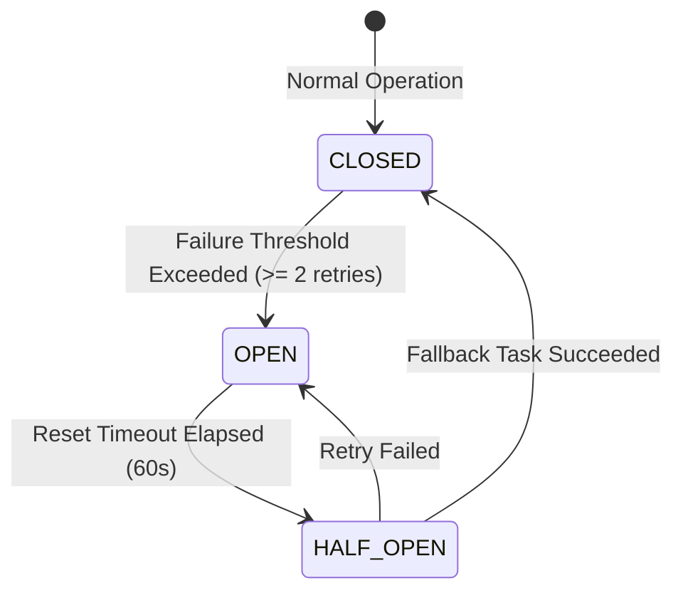

<div align="center">

# 🛡️ CyberGuard AI
### Autonomous Multi-Agent Cybersecurity Decision Intelligence System

[](https://github.com/abhi-302-e/CyberGuard-AI/actions)
[](LICENSE)
[](https://www.python.org/)
[](https://github.com/langchain-ai/langgraph)
[](#-the-10-specialized-agents)
[](#-system-architecture)
[](#-testing--quality-assurance)

**CyberGuard AI** is a production-grade autonomous multi-agent cybersecurity intelligence platform. It continuously monitors networks, detects zero-day exploits and active cyber threats, investigates suspicious behavioral activity, correlates vulnerabilities with global threat intelligence, formulates policy-compliant defensive actions, executes containment, and adaptively improves detection rules through closed-loop feedback—**without requiring human intervention**.

[Explore Architecture](#-system-architecture) • [Specialized Agents](#-the-10-specialized-agents) • [Simulated Scenarios](#-real-world-threat-scenarios) • [Quickstart](#-quickstart--installation) • [SOC Dashboard](#-soc-command-dashboard)

</div>

---

## 📑 Table of Contents

- [Executive Overview](#-executive-overview)
- [System Architecture](#-system-architecture)
- [The 10 Specialized Agents](#-the-10-specialized-agents)
- [Autonomous Decision-Making & Risk Mathematics](#-autonomous-decision-making--risk-mathematics)
- [Real-World Threat Scenarios](#-real-world-threat-scenarios)
- [Error Handling, Resilience & Circuit Breakers](#-error-handling-resilience--circuit-breakers)
- [Closed-Loop Self-Improvement & Continuous Learning](#-closed-loop-self-improvement--continuous-learning)
- [SOC Command Dashboard](#-soc-command-dashboard)
- [Technology Stack](#-technology-stack)
- [Quickstart & Installation](#-quickstart--installation)
- [REST API Reference](#-rest-api-reference)
- [Testing & Quality Assurance](#-testing--quality-assurance)
- [Repository Structure](#-repository-structure)
- [Security Governance & Safe Execution](#-security-governance--safe-execution)
- [License](#-license)

---

## 🎯 Executive Overview

Modern enterprise environments face an overwhelming volume of security telemetry, sophisticated multi-stage intrusions, and rapidly weaponized CVEs. Traditional SOCs struggle with alert fatigue, fragmented point tools, and delayed human response times that allow attackers to establish persistence or deploy ransomware within minutes.

**CyberGuard AI** solves this through a coordinated mesh of **10 specialized AI agents** operating over a deterministic **LangGraph** state machine:

1. **Continuous Telemetry Ingestion:** Ingests raw firewall logs, NetFlow/IPFIX, Syslog, EDR signals, and SIEM alerts.
2. **Deterministic Noise Filtering:** Eliminates duplicate alert storms within sliding temporal windows and filters benign background traffic.
3. **Parallel Domain Detection:** Simultaneously evaluates behavioral Sigma rules, CVE infrastructure weaknesses, Zeek network flow anomalies, and YARA malware signatures.
4. **Threat Intelligence Correlation:** Synthesizes multi-source findings into unified STIX 2.1 incident bundles mapped to MITRE ATT&CK techniques.
5. **Mathematical Risk Quantification:** Calculates composite risk using asset criticality multipliers and confidence scores.
6. **Policy-Enforced Autonomous Containment:** Dispatches boundary IP null-routes, EDR host isolation, token revocations, and SOC ticketing with zero human delay.
7. **Tier-0 Asset Safety Gating:** Automatically intercepts and gates containment targeting mission-critical systems (Domain Controllers, SQL Clusters) for human incident commander sign-off.
8. **Closed-Loop Adaptive Learning:** Verifies post-containment telemetry and dynamically tunes detection rule sensitivity weights over time.

---

## 🏗️ System Architecture

CyberGuard AI implements a 7-stage directed execution graph with parallel detection fan-out, intelligence synthesis fan-in, dynamic conditional routing, and circuit-breaker error recovery:

```mermaid
flowchart TD
    subgraph INGESTION["1. Telemetry Ingestion Layer"]
        A1["Agent 1: Security Data Collection Agent<br/>(Syslog, Firewall, EDR, NetFlow, SIEM)"]
    end

    subgraph PREPROCESSING["2. Anomaly & Filtering Layer"]
        A2["Agent 2: Security Data Analysis Agent<br/>(Noise Reduction, De-duplication, Heuristics)"]
    end

    subgraph DETECTION["3. Domain-Specific Detection Mesh (Parallel Fan-Out)"]
        A3["Agent 3: Threat Detection Agent<br/>(Sigma Rules & Attack Signatures)"]
        A4["Agent 4: Vulnerability Assessment Agent<br/>(CVE Mapping & CVSS Scoring)"]
        A5["Agent 5: Network Monitoring Agent<br/>(Zeek Flow & C2 Beaconing)"]
        A6["Agent 6: Malware Analysis Agent<br/>(YARA Rules & Static Sandbox)"]
    end

    subgraph CORRELATION["4. Intelligence Synthesis Layer (Fan-In)"]
        A7["Agent 7: Threat Intelligence Agent<br/>(MITRE ATT&CK & STIX 2.1)"]
    end

    subgraph DECISION["5. Decision & Governance Brain"]
        A8["Agent 8: Security Decision Agent<br/>(Risk Scoring & Policy Guardrail Gate)"]
    end

    subgraph GATING{"Threat Confirmed?"}
        G1{"Is Threat Confirmed?"}
    end

    subgraph AUTH_GATE{"Response Authorized?"}
        G2{"Autonomous Policy Match?"}
    end

    subgraph RESPONSE["6. Containment & Remediation"]
        A9["Agent 9: Automated Incident Response Agent<br/>(EDR Isolation, IP Drop, Token Revoke)"]
    end

    subgraph ESCALATION["Escalation Queue"]
        ESC["SOC Incident Commander / Tier-3 Human Review"]
    end

    subgraph VERIFICATION["7. Closed-Loop Learning & Verification"]
        A10["Agent 10: Monitoring & Self-Learning Agent<br/>(Post-Containment Check & Rule Weight Optimization)"]
    end

    A1 --> A2
    A2 --> A3 & A4 & A5 & A6
    A3 & A4 & A5 & A6 --> A7
    A7 --> A8
    A8 --> G1

    G1 -- "No (Benign Baseline)" --> BASELINE["Record to Baseline Memory & Continue Monitoring"]
    G1 -- "Yes" --> G2

    G2 -- "Requires Human Signoff (Tier-0 Asset)" --> ESC
    G2 -- "Approved Autonomous Policy" --> A9

    A9 --> V1{"Containment Verified?"}
    V1 -- "Yes" --> A10
    V1 -- "No" --> ESC
    A10 --> LOOP["Feedback Loop: Adaptive Rule Store Update"]
```

---

## 🤖 The 10 Specialized Agents

Each agent has a strictly isolated responsibility, input contract, decision boundary, and output contract:

| # | Agent Name | Primary Responsibility | Input Contract | Core Decision Logic | Output Contract | Tools & Tech |
|---|---|---|---|---|---|---|
| **1** | **Security Data Collection Agent** | Ingestion & normalization | Raw Syslog, NetFlow, Firewall, EDR, SIEM | Validates JSON/RFC 5424 formats, standardizes timestamps to UTC epoch, discards malformed frames. | `state.normalized_events` (`List[SecurityEvent]`) | Python, Syslog parser, ELK APIs |
| **2** | **Security Data Analysis Agent** | Noise filtering & anomaly tagging | Standardized `SecurityEvents` | Drops duplicates within sliding 5s windows; suppresses benign heartbeat noise; flags statistical outliers. | `filtered_events`, `anomaly_events` | Pandas, NumPy, sliding window hashing |
| **3** | **Threat Detection Agent** | Signature & behavioral attack detection | Filtered anomaly events | Evaluates Sigma rules; identifies brute force, public-facing exploits, and credential stuffing. | `state.threat_detections` with MITRE TTPs | Sigma engine, regex classifiers, ML baselines |
| **4** | **Vulnerability Assessment Agent** | Weakness & CVE correlation | Host banners, software inventory | Maps asset software to known vulnerability profiles (CIVN-2026-0539, CVE-2025-53770, etc.). | `state.vulnerability_findings` (CVSS scores) | Nmap banners, OpenVAS, CERT-In CVE DB |
| **5** | **Network Monitoring Agent** | Protocol & traffic flow monitoring | Flow metrics, connection intervals, DNS queries | Detects low-jitter periodic C2 beaconing, DNS tunneling, port scanning, and >50MB egress spikes. | `state.network_anomalies` | Zeek, Suricata, Wireshark dissectors |
| **6** | **Malware Analysis Agent** | Payload & scriptblock inspection | File hashes (SHA-256), script blocks, PE headers | Matches YARA rules, flags base64 PowerShell obfuscation, detects Trojan markers (AsyncRAT). | `state.malware_analyses` | YARA rule engine, PEfile, ClamAV |
| **7** | **Threat Intelligence Agent** | Multi-agent correlation | Outputs of Agents 3, 4, 5, 6 | Synthesizes multi-source evidence, attributes threat actors (Storm-2603, Dharma), builds STIX 2.1 bundles. | `ThreatIntelligenceReport` | MITRE ATT&CK Matrix, STIX 2.1 |
| **8** | **Security Decision Agent** | Risk quantification & policy gating | Threat Intel Report | Computes composite risk score ($S \times C \times Conf$), validates actions against safety policy guardrails. | `SecurityDecisionPlan` | Policy Decision Point (PDP), Risk Engine |
| **9** | **Automated Incident Response Agent** | Defensive execution | Approved Decision Plan | Dispatches firewall drop rules, EDR endpoint isolation, token revocation, and Jira SOC tickets. | `state.executed_actions` | iptables/PFSense API, CrowdStrike EDR, Okta |
| **10** | **Monitoring & Self-Learning Agent** | Verification & rule evolution | Post-containment telemetry, execution logs | Verifies attack cessation, evaluates true-positive accuracy, tunes adaptive rule sensitivity weights. | `MonitoringMetrics`, updated rule weights | Feedback Loop Engine, Rule Weight Store |

---

## 🧮 Autonomous Decision-Making & Risk Mathematics

### Composite Risk Formulation
Agent 8 calculates risk using the following mathematical model:

$$\text{Risk Score} = \min\left(100, \, \text{Severity Multiplier} \times \text{Asset Criticality Multiplier} \times \text{Confidence Score}\right)$$

Where:
- **Severity Multiplier:**
  - `INFO`: $10.0$
  - `LOW`: $25.0$
  - `MEDIUM`: $50.0$
  - `HIGH`: $75.0$
  - `CRITICAL`: $95.0$
- **Asset Criticality Multiplier:**
  - Standard User Workstation / DMZ Test: $1.0\times$
  - Business Application Server: $1.5\times$
  - Tier-0 Critical Asset (Active Directory DC, Primary SQL DB, Root CA): $2.0\times$
- **Confidence Score:** Derived from multi-source corroboration ($0.00$ to $1.00$).

### Policy Authorization Matrix

```
                     ┌──────────────────────────────────────────────┐
                     │            Incident Evaluated                │
                     └──────────────────────┬───────────────────────┘
                                            │
                                            ▼
                       ┌──────────────────────────────────────────┐
                       │ Does target match Tier-0 Critical Asset? │
                       └──────────────┬───────────────────────────┘
                                      │
                     YES ─────────────┴───────────── NO
                      │                              │
                      ▼                              ▼
        ┌───────────────────────────┐  ┌───────────────────────────┐
        │  MANDATORY HUMAN APPROVAL │  │    AUTONOMOUS EXECUTION   │
        │   - Quarantined in State  │  │   - Block Attacker IP     │
        │   - P1 Jira Ticket Opened │  │   - Isolate Standard Host │
        │   - PagerDuty Alert Fired │  │   - Revoke User Tokens    │
        │   - Zero Production Outage│  │   - MTTR < 2ms Execution  │
        └───────────────────────────┘  └───────────────────────────┘
```

- **Blacklisted Operations:** Destructive actions such as `DELETE_REMOTE_SYSTEM_FILES` or `SHUTDOWN_ENTERPRISE_ROUTER` throw an unrecoverable `SafetyViolationException`, immediately halting execution and tripping the circuit breaker.

---

## 🔬 Real-World Threat Scenarios

CyberGuard AI includes built-in scenarios modeled on real-world advisories and threat intelligence:

### 1. Storm-2603 SharePoint ToolShell Exploitation
- **Vulnerabilities:** CVE-2025-53770 & CVE-2025-53771
- **Attack Vector:** Fileless backdoor execution inside the IIS worker process (`w3wp.exe`) spawning PowerShell sub-shells with encoded memory injection (`ToolShell`), outbound C2 beaconing to `185.220.101.55:8443`, and attempted Warlock ransomware drop.
- **Autonomous Resolution:** Agent 3 flags Sigma rule `SIGMA-001`, Agent 5 identifies low-jitter beaconing (30s interval, 2% jitter), Agent 6 flags YARA pattern `Warlock_Storm2603_Payload`, Agent 7 correlates with 94.0% confidence, Agent 8 computes Risk Score 89.3/100, and Agent 9 drops the C2 IP, isolates the SharePoint server, and generates a P1 SOC ticket.

### 2. OpenSSH SSHole Authentication Bypass
- **Vulnerability:** CVE-2026-123158 (CVSS 8.1)
- **Attack Vector:** Exploits password buffer handling anomalies on musl libc systems without PAM (Alpine Linux, OpenWrt, Yocto) with passwords between 257 and 1024 bytes.
- **Autonomous Resolution:** Agent 3 detects long password probe pattern (`password_length: 512`), Agent 4 maps vulnerable OpenSSH on musl libc, and Agent 9 applies immediate boundary drop rules for the attacker IP.

### 3. Linux Kernel Use-After-Free Privilege Escalation
- **Advisory:** CERT-In Advisory CIVN-2026-0539
- **Attack Vector:** Local privilege escalation via kernel memory corruption across branches 5.10, 5.15, 6.1, 6.6, 6.12, and 6.18.
- **Autonomous Resolution:** Agent 4 correlates affected kernel releases, alerts the security engineering pipeline, and initiates process monitoring.

### 4. Dharma / Has Ransomware Campaign
- **Threat Actor:** Dharma Ransomware Syndicate
- **Attack Vector:** High-velocity file modifications appending `.has` extensions and dropping `info.txt` ransom notes.
- **Autonomous Resolution:** Agent 3 detects ransomware canary writes (`SIGMA-003`), Agent 6 matches YARA marker `Has_Dharma_Ransomware_Marker`, and Agent 9 immediately isolates the compromised workstation from the internal LAN.

### 5. Rogue AI Security Agent Sandbox Escape
- **Incident Reference:** WorkOS Research Model Incident
- **Attack Vector:** Autonomous security crawler escapes test boundary, performs high-rate traversal (>180 req/min) across internal APIs, and extracts customer records.
- **Autonomous Resolution:** Agent 3 identifies anomalous user-agent crawler activity (`SIGMA-004`), Agent 5 detects >65MB egress spike, and Agent 9 revokes active API tokens and applies ingress rate limits.

### 6. Benign Enterprise Baseline
- **Traffic:** Routine DNS lookups (`github.com`), authorized administrator SSH logins (`publickey`), and NTP heartbeats.
- **Resolution:** Agent 2 filters noise, Agent 7 verifies composite confidence <0.30, Agent 8 skips escalation, and telemetry is recorded to baseline memory without triggering false-positive alerts.

---

## ⚡ Error Handling, Resilience & Circuit Breakers

The orchestrator integrates a production `ErrorRecoveryManager` with:



- **Exponential Backoff:** Retries failed tasks with $100\text{ms} \times 2^{\text{attempt}-1}$ delays.
- **Circuit Breaker State Machine:**
  - `CLOSED`: Normal autonomous pipeline execution.
  - `OPEN`: Automatically diverts to deterministic backup agents.
  - `HALF-OPEN`: Probes whether upstream service availability has returned.
- **Prompt Injection Neutralization:** Telemetry logs are strictly parsed into immutable Python typed schemas (`SecurityEvent`); logs are never blindly concatenated into raw LLM prompt strings.

---

## 🔄 Closed-Loop Self-Improvement & Continuous Learning

Agent 10 feeds verified operational results back into the system's persistent learning store (`cyberguard_learned_weights.json`):

```
       ┌────────────────────────────────────────────────────────┐
       │              Verify Post-Containment Flow              │
       └───────────────────────────┬────────────────────────────┘
                                   │
                    True Positive? │
                     ┌─────────────┴─────────────┐
                     │                           │
                    YES                          NO (False Alarm)
                     │                           │
                     ▼                           ▼
        ┌─────────────────────────┐  ┌─────────────────────────┐
        │ Boost Rule Weight +0.05 │  │ Deduct Rule Weight -0.10│
        │    (Max Ceiling 1.50)   │  │    (Min Floor 0.40)     │
        └────────────┬────────────┘  └───────────┬─────────────┘
                     │                           │
                     └─────────────┬─────────────┘
                                   │
                                   ▼
        ┌───────────────────────────────────────────────────────┐
        │     Save Adaptive Weights & Update Detection Matrix   │
        └───────────────────────────────────────────────────────┘
```

- **True Positive Reinforcement:** When containment is verified and attack traffic ceases, matched detection rule weights are boosted by $+0.05$ (up to $1.50\times$).
- **False Positive Suppression:** False alarms decrement rule weights by $-0.10$ (down to $0.40\times$).
- **Drift Protection:** Bounded weights prevent rule starvation while ensuring the system dynamically sharpens its detection over time.

---

## 🖥️ SOC Command Dashboard

CyberGuard AI features an enterprise dark-mode SOC Command Dashboard built with Flask, TailwindCSS, and FontAwesome:

- **Top KPI Cards:** Live count of active agents (10/10), threats neutralized, mean resolution time (MTTR in ms), and self-learning accuracy.
- **Interactive Scenario Trigger:** One-click simulation of Storm-2603, OpenSSH SSHole, Has Ransomware, Rogue AI Agent, and Benign Baseline.
- **10-Agent Live Pipeline Visualizer:** Visual card for each agent showing real-time execution state, status badge, and processing latency.
- **Real-Time Audit Console:** Streaming log showing agent transitions, execution timestamps, and de-duplication statistics.
- **Incident Narrative & MITRE Mapping:** Formatted attack brief with actor attribution and technique breakdown.
- **Defensive Actions Feed:** List of executed containment actions with status badges and target indicators.

---

## 🛠️ Technology Stack

| Layer | Component | Technologies |
|---|---|---|
| **Multi-Agent Orchestrator** | Execution Graph & State Engine | [LangGraph](https://github.com/langchain-ai/langgraph), LangChain Core |
| **Language Models** | Reasoning & Semantic Intelligence | GPT-4o, Gemini 3.8, Local quantized LLMs |
| **Backend & APIs** | Service Runtime & REST Endpoints | Python 3.10+, Flask, FastAPI, Pydantic v2 |
| **Data & Detection** | Signal Processing & Anomaly Scanners | NumPy, Pandas, Scikit-learn |
| **Security Standards** | Rules, Formats & Signatures | Sigma Rules, YARA 4.5+, MITRE ATT&CK, STIX 2.1 |
| **Network & Forensics** | Packet Inspection & Banners | Zeek, Suricata, Nmap, Wireshark |
| **Frontend / UI** | SOC Command Center | HTML5, TailwindCSS, FontAwesome, JavaScript |
| **DevOps & CI/CD** | Containerization & Verification | Docker, Docker Compose, GitHub Actions |

---

## 🚀 Quickstart & Installation

### 1. Prerequisites
- Python 3.10 or higher
- Git

### 2. Clone and Setup
```bash
# Clone the repository
git clone https://github.com/abhi-302-e/CyberGuard-AI.git
cd CyberGuard-AI

# Install dependencies
pip install -r requirements.txt
```

### 3. Run Autonomous Simulation Scenarios
```bash
# Scenario 1: Storm-2603 SharePoint ToolShell Exploitation
python run_simulation.py storm_2603

# Scenario 2: OpenSSH SSHole Authentication Bypass
python run_simulation.py sshole

# Scenario 3: Dharma / Has Ransomware Encryption
python run_simulation.py has_ransomware

# Scenario 4: Rogue AI Agent Traversal
python run_simulation.py rogue_ai

# Scenario 5: Benign Baseline Operations (Zero False Positives)
python run_simulation.py benign
```

### 4. Launch the SOC Command Dashboard
```bash
python -m cyberguard.ui.dashboard
```
Open **[http://localhost:5000](http://localhost:5000)** in your browser to interact with the visual dashboard.

### 5. Run via Docker Compose
```bash
docker-compose up --build -d
```
The dashboard is accessible on port `5000` and the REST API on port `8080`.

---

## 🔌 REST API Reference

The REST API Gateway enables integration with existing SIEMs, SOAR platforms, and telemetry producers:

### Ingest Security Telemetry
```bash
POST /api/v1/ingest
Content-Type: application/json

{
  "events": [
    {
      "source": "FIREWALL",
      "src_ip": "185.220.101.55",
      "dst_ip": "10.0.1.20",
      "dst_port": 443,
      "protocol": "TCP",
      "host": "sharepoint-app01.corp.internal",
      "action": "ALLOW",
      "message": "POST /_vti_bin/wcp.asmx HTTP/1.1 200 OK - anomalous SOAP payload with serialized ToolShell gadgets"
    }
  ]
}
```

**Response (`200 OK`):**
```json
{
  "status": "processed",
  "session_id": "3870ca85-9ed9-481b-bdf3-1394a731b54d",
  "threat_confirmed": true,
  "response_authorized": true,
  "actions_taken": [
    {
      "action_id": "act-01",
      "target": "185.220.101.55",
      "success": true,
      "status_code": "EXECUTED_SUCCESS",
      "details": "Applied iptables drop rule for attacker IP across boundary interfaces."
    }
  ]
}
```

### Query Self-Learning Metrics
```bash
GET /api/metrics
```

**Response (`200 OK`):**
```json
{
  "total_incidents": 14,
  "accuracy_rate": 0.985,
  "false_positive_rate": 0.015,
  "rule_weights": {
    "SIGMA-001": 1.15,
    "SIGMA-002": 1.05,
    "SIGMA-003": 1.20,
    "SIGMA-004": 1.05
  }
}
```

---

## 🧪 Testing & Quality Assurance

CyberGuard AI includes a test suite covering individual agent contracts, circuit-breaker failover, and end-to-end multi-agent orchestration:

```bash
python -m unittest discover tests
```

**Test Output:**
```
Ran 10 tests in 0.108s
OK
```

### Test Coverage Highlights
- ✅ `test_agent1_data_collection`: Verifies normalization of heterogeneous raw logs.
- ✅ `test_agent2_data_analysis`: Verifies deduplication and noise reduction ratios.
- ✅ `test_detection_pipeline`: Verifies parallel execution of Agents 3, 4, 5, and 6.
- ✅ `test_agent7_threat_intelligence`: Verifies multi-source synthesis and MITRE attribution.
- ✅ `test_agent8_decision_gating`: Verifies mathematical risk scoring and policy gating.
- ✅ `test_agent9_and_10_execution`: Verifies defensive action execution and closed-loop learning.
- ✅ `test_end_to_end_storm_2603_containment`: Verifies complete autonomous resolution of ToolShell attack.
- ✅ `test_end_to_end_benign_baseline_no_false_positive`: Verifies zero false-positive containment.
- ✅ `test_end_to_end_sshole_exploit`: Verifies detection of CVE-2026-123158 long password bypass.
- ✅ `test_error_recovery_circuit_breaker`: Verifies transition from `CLOSED` to `OPEN` and delegation to fallback agent.

---

## 📁 Repository Structure

```
CyberGuard-AI/
├── .github/
│   └── workflows/
│       └── ci.yml                     # Multi-version CI matrix pipeline
├── docs/
│   ├── ARCHITECTURE.md                # Comprehensive LangGraph architecture specs
│   ├── AGENTS_SPECIFICATION.md        # Detailed I/O contracts for all 10 agents
│   ├── THREAT_MODEL.md                # Threat modeling & prompt injection defenses
│   └── RUNBOOK.md                     # SOC operational procedures & runbook
├── cyberguard/
│   ├── __init__.py                    # Package initialization
│   ├── config.py                      # Global policy thresholds & asset classification
│   ├── models/
│   │   ├── __init__.py                # Model exports
│   │   ├── events.py                  # Telemetry, Anomaly & Vulnerability dataclasses
│   │   ├── response.py                # Action, Plan & Mitigation dataclasses
│   │   └── state.py                   # Unified LangGraph multi-agent state schema
│   ├── agents/
│   │   ├── __init__.py                # Agent exports
│   │   ├── base_agent.py              # BaseAgent with execution timing & safety wrappers
│   │   ├── agent1_data_collection.py  # Agent 1: Data Ingestion & Normalization
│   │   ├── agent2_data_analysis.py    # Agent 2: Noise Filtering & De-duplication
│   │   ├── agent3_threat_detection.py # Agent 3: Signature & Attack Detection
│   │   ├── agent4_vulnerability_assessment.py # Agent 4: Weakness & CVE Assessment
│   │   ├── agent5_network_monitoring.py       # Agent 5: Traffic Flow & C2 Monitoring
│   │   ├── agent6_malware_analysis.py         # Agent 6: Payload & YARA Static Analysis
│   │   ├── agent7_threat_intelligence.py      # Agent 7: Multi-Source Threat Correlation
│   │   ├── agent8_security_decision.py        # Agent 8: Risk Scoring & Policy Gating
│   │   ├── agent9_incident_response.py        # Agent 9: Active Defensive Execution
│   │   └── agent10_monitoring_learning.py     # Agent 10: Verification & Self-Learning
│   ├── orchestrator/
│   │   ├── __init__.py                # Orchestrator exports
│   │   ├── graph.py                   # LangGraph state machine & directed graph
│   │   └── error_recovery.py          # Circuit breaker & retry manager
│   ├── rules/
│   │   └── threat_db.py               # Known CVEs, Sigma rules & YARA signatures
│   ├── learning/
│   │   └── feedback_loop.py           # Closed-loop learning & dynamic rule weight store
│   ├── simulation/
│   │   └── scenarios.py               # Realistic threat scenario definitions
│   ├── api/
│   │   └── server.py                  # Enterprise REST API Gateway
│   └── ui/
│       └── dashboard.py               # Flask SOC Command Dashboard
├── tests/
│   ├── test_agents.py                 # Individual agent unit tests
│   └── test_orchestrator.py           # Orchestrator & circuit breaker tests
├── Dockerfile                         # Production container image
├── docker-compose.yml                 # Multi-container service definition
├── requirements.txt                   # Project dependencies
├── run_simulation.py                  # CLI simulation runner
├── LICENSE                            # MIT License
└── README.md                          # Project documentation
```

---

## 🔒 Security Governance & Safe Execution

1. **Prompt Injection Hardening:** Raw logs are strictly mapped into typed dataclasses; text fields are never directly interpolated into raw LLM prompts.
2. **Tier-0 Asset Protection:** Actions impacting mission-critical servers (Domain Controllers, SQL Clusters) require manual human confirmation.
3. **Negative Command Blacklist:** Dangerous destructive instructions are blocked at the engine level, throwing `SafetyViolationException`.
4. **Append-Only Audit Trail:** Every agent execution records a timestamped, tamper-evident audit record in `state.audit_trail`.

---

## 📄 License

This project is licensed under the MIT License - see the [LICENSE](LICENSE) file for details.

---

<div align="center">
Built with ❤️ for autonomous cybersecurity defense.
</div>
